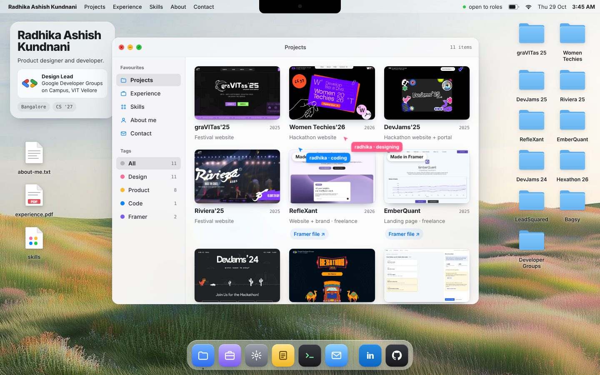

# radhika.OS

My portfolio, built to feel like a Mac desktop.

**→ [radhikakundnani.github.io](https://radhikakundnani.github.io)**

Open the folders to see my projects, drag the windows around, or check out the terminal.

Built with plain HTML, CSS and JavaScript, hosted on GitHub Pages.

[LinkedIn](https://www.linkedin.com/in/radhika-kundnani/) · [Email](mailto:radhikakundnani1@gmail.com)
