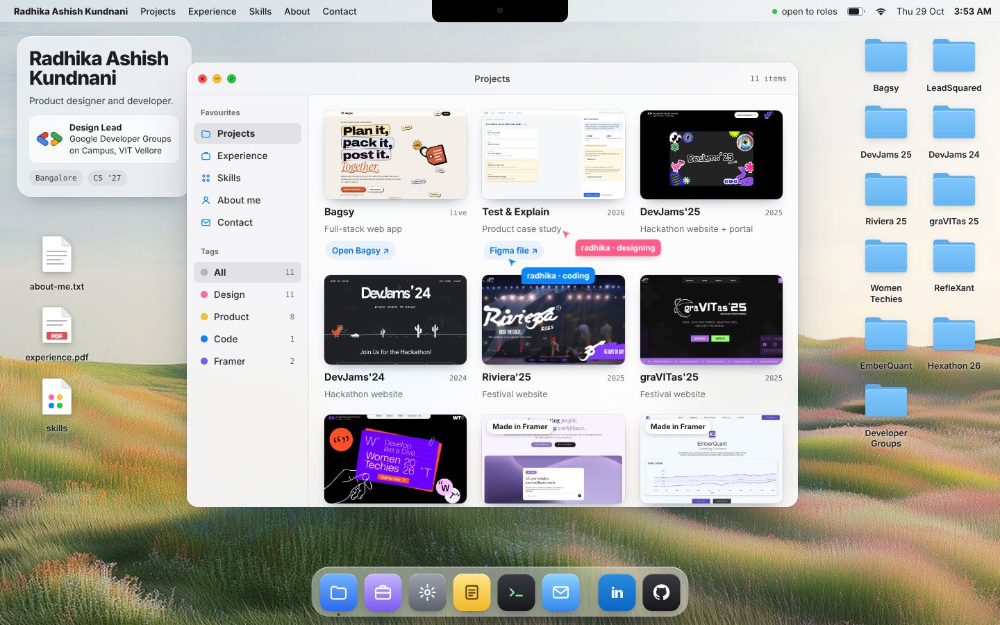

# radhika.OS

My portfolio, built to feel like a Mac desktop.

**→ [radhikakundnani.github.io](https://radhikakundnani.github.io)**

[](https://radhikakundnani.github.io)

Open the folders to see my projects, drag the windows around, or check out the terminal.

Built with plain HTML, CSS and JavaScript, hosted on GitHub Pages.

[LinkedIn](https://www.linkedin.com/in/radhika-kundnani/) · [Email](mailto:radhikakundnani1@gmail.com)

## How it's built

```
index.html            the page: menu bar, desktop, dock, boot screen
css/styles.css        all the styling, plus the phone layout
js/
  main.js             entry point: clicks, dragging, keyboard, boot
  data.js             projects, experience and skills (edit content here)
  views.js            the HTML for each window
  window-manager.js   opening, closing, focusing and stacking windows
  boot.js             the loading screen that writes "radhika"
  desktop.js          desktop folders, phone home screen, clock
  jiggle.js           press and hold an icon on a phone to make them wiggle
  scene.js            the layered hills: parallax on scroll and mouse, plus the footer
  state.js            what's selected right now
  utils.js            small shared helpers
  icons.js            inline SVG icons
assets/
  projects/           project screenshots
  scene/              the wallpaper split into sky, far hills and near hills
  ui/                 wallpaper, logo, preview, icons
favicon.svg / .ico    my "rak" monogram
```

No frameworks or build step. The JavaScript is split into ES modules that the browser loads directly.
